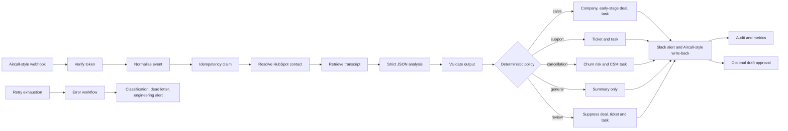

# AI Post-Call Revenue Orchestrator

An n8n integration prototype that turns an Aircall-style `call.ended` event into guarded HubSpot actions, Slack review, telephony write-back, audit records, and operational metrics.

It demonstrates the work behind a forward-deployed integration: normalising a provider webhook, resolving CRM state, constraining an LLM to structured output, applying deterministic policy, making downstream writes idempotent, and exposing failures for replay.

> [!IMPORTANT]
> This is a locally validated prototype, not a production Aircall deployment. The automated tests use mock Aircall, HubSpot, OpenAI, and Slack services. No live provider account or production data was used to validate the repository.

## System at a glance



The project contains three workflows:

| Workflow | Responsibility |
|---|---|
| `00-setup-hubspot-and-aircall.json` | Defines HubSpot properties, demo contacts, and optional Aircall-style tags. |
| `01-aircall-hubspot-ai-call-intelligence.json` | The 63-node orchestration flow, organised into eight labelled sections. |
| `02-error-handler.json` | Classifies terminal failures, records a bounded dead-letter entry, and alerts engineering. |

`src/code/` is the readable source for Code nodes. `src/build.mjs` assembles the importable workflow JSON and checks that generated workflows have not drifted from source.

## What the prototype demonstrates

- REST integration across telephony, CRM, model, and messaging boundaries.
- A canonical event model that isolates downstream logic from provider payloads.
- Duplicate protection using `aircall:<event>:<call_id>`.
- Strict JSON-schema model output plus application-level validation.
- A closed intent/action vocabulary and explicit prompt-injection handling.
- Deterministic routing and commercial guardrails after model inference.
- Human review for low confidence, unknown intent, malformed output, missing transcripts, and requests involving discounts, refunds, contracts, or guarantees.
- Retry, failure classification, replay behaviour, audit records, and aggregate metrics.
- A source-generated n8n workflow that remains reviewable outside the visual editor.

## Guardrail boundary

The model may summarise, classify, extract facts, recommend one allow-listed next action, and draft a follow-up. It cannot directly close a deal, change a contract, issue a refund or credit, apply a discount, or send an email.

Policy sends a call to review when any of these conditions apply:

- Confidence is below `0.85`.
- Intent is `unknown`.
- Structured output fails validation.
- The transcript is empty or unavailable.
- The caller requests a consequential commercial commitment.
- A cancellation comes from a number not linked to a known customer.

The review route suppresses contact updates, deals, tickets, and tasks. The current flow may already have created an `Unknown Caller` contact and always writes a review-labelled summary note before the route gate. Those are CRM writes, so this repository deliberately does **not** describe review as having “no side effects.”

## Example routes

| Fixture | Policy result | Downstream behaviour |
|---|---|---|
| Sales prospect | Qualified sales | Contact enrichment, company, allow-listed early-stage deal, task, alert. |
| Existing customer support issue | Support | Ticket and callback task. |
| Cancellation signal | Cancellation | Churn-risk update and customer-success task due within four hours. |
| Short ambiguous call | Review | Review-labelled note and alert; no deal, ticket, task, or contact update. |
| Prompt-injection/discount request | Review | Consequential actions suppressed despite high model confidence. |

All people, companies, phone numbers, and transcripts in `fixtures/` are synthetic.

## Design decisions

### Normalise once

Only `Normalize Payload` understands the provider schema. CRM, policy, notification, and audit nodes consume one canonical call object, reducing the cost of adapting another telephony provider.

### AI proposes; policy decides

The model uses strict structured output, but its response is still untrusted. `Validate AI Output` checks types, enums, bounds, and required fields. `Guardrail Policy` then applies CRM facts and business rules. This separation makes consequential behaviour reviewable without reading a prompt.

### Gate consequences, retain evidence

A review-labelled note preserves why a call was held. More consequential changes sit behind the policy gate. Contact enrichment fills empty values and does not intentionally overwrite human-entered fields.

### Treat delivery as at-least-once

The local demo uses n8n workflow static data for duplicate suppression. A Postgres design in `sql/idempotency_postgres.sql` shows an atomic claim for multi-worker execution. That database design is documented but is not wired into the executable demo.

### Keep workflow code reviewable

Small JavaScript files map one-to-one to Code nodes. The build script owns layout and connections. `npm run validate` compiles every Code-node source file and verifies that committed public workflow JSON is byte-for-byte current.

## Fastest local review

Validate the source/workflow boundary without installing n8n:

```bash
npm run validate
```

Open `workflows/01-aircall-hubspot-ai-call-intelligence.json` in n8n to inspect the labelled canvas. The fixture names in `fixtures/webhooks/` describe the five business scenarios and four intake edge cases.

## Full mocked demo

The end-to-end test requires n8n `2.40.5`. Install it in a disposable directory rather than adding thousands of runtime dependencies to this repository:

```bash
mkdir -p .local-n8n
cd .local-n8n
npm init -y
npm install node@24 n8n@2.40.5
cd ..
```

Run three terminals:

```bash
# Terminal 1
.local-n8n/node_modules/.bin/node test/mock-server.mjs

# Terminal 2: generates the test build, imports it, publishes it, and starts n8n
N8N_DIR="$PWD/.local-n8n" ./test/run-local-n8n.sh

# Terminal 3
.local-n8n/node_modules/.bin/node test/e2e.mjs
```

The runner creates a fresh temporary data directory for each run and prints its location. It refuses a caller-supplied `N8N_USER_FOLDER`, so an existing n8n installation cannot be reset accidentally. Temporary test data is retained for inspection after the server stops.

## Tested boundary

The automated suite has been run end to end on a real local n8n `2.40.5` runtime against local mocks. It covers:

- Five business scenarios: sales, support, cancellation, review, and prompt injection.
- Four intake edge cases: invalid token, unanswered call, anonymous caller, and irrelevant event.
- Duplicate event delivery.
- Slack approval URL resuming the paused workflow and recording an approved draft as a HubSpot note.
- A HubSpot `503` outlasting three node attempts, reaching the error workflow, and succeeding after redelivery once the demo lock expires.
- Metrics aggregation.

The test does **not** validate live provider schemas, OAuth/scopes, provider rate limits, real Slack interactivity, the setup workflow being run twice, Postgres idempotency, horizontally scaled n8n, or actual email delivery. The setup workflow is imported during the test boot, but the suite seeds equivalent mock data directly rather than executing setup.

## Security notes

This is an independent portfolio project. It is not affiliated with or endorsed by Aircall, HubSpot, OpenAI, Slack, or n8n. Product names identify the interfaces being demonstrated. No open-source license grant has been selected for the original project code.

- Fixture transcripts are treated as untrusted text; instructions inside them do not override the system rules.
- The public workflow contains placeholder configuration only. Real webhook tokens and provider credentials must stay in n8n credentials or a managed secret store.
- External HTTP nodes retry three times. Slack and telephony write-back are non-critical and recorded in the audit result when they fail.
- Test credentials are explicit mock values generated under ignored `test/.generated/`.
- The current n8n Wait resume URL is a bearer capability shared through Slack. It is adequate for a local prototype, not a production approval control.
- The metrics endpoint is unauthenticated in the demo and returns recent audit records. It must not be exposed publicly in this form.

## Production considerations

Before a live deployment I would:

1. Validate current Aircall, HubSpot, OpenAI, and Slack request/response contracts in provider sandboxes.
2. Move secrets and per-customer configuration out of Code nodes and into managed configuration.
3. Replace static-data idempotency/audit storage with Postgres transactions and per-side-effect checkpoints.
4. Put ingestion behind a durable queue with explicit retry/backoff and dead-letter operations.
5. Replace bearer approval URLs with an authenticated approval service that verifies Slack signatures, actor identity, expiry, and replay.
6. Protect metrics, remove record-level data from the aggregate endpoint, and add retention/redaction rules.
7. Map the Aircall agent to an authorised HubSpot owner and enforce tenant/account isolation.
8. Add an evaluation set of labelled transcripts and monitor accuracy by prompt version, route, and confidence band.
9. Add reconciliation jobs for partially completed CRM writes and write-back failures.
10. Run privacy, call-recording-consent, data-residency, and retention reviews for the deployment region.

## Known limitations

- Provider integrations are mocked; “Aircall-style” describes the event contract used by the fixture, not a certified Aircall integration.
- Static n8n data is single-workflow demo storage and is not a transactional multi-worker ledger.
- A failure after an early CRM write can leave partial state. The demo replay reuses contacts but does not checkpoint every side effect.
- Draft approval records a note; it does not send an email.
- Webhook token comparison and approval links are prototype controls, not a complete authentication/authorisation design.
- Audit/dead-letter records are bounded in-memory workflow data rather than a durable operational store.

## Repository map

| Path | Purpose |
|---|---|
| `src/build.mjs` | Workflow graph, node configuration, deterministic IDs, generation/consistency checks. |
| `src/code/` | Reviewable JavaScript for individual Code nodes. |
| `workflows/` | Importable public n8n workflow JSON. |
| `fixtures/webhooks/` | Synthetic Aircall-shaped webhook examples. |
| `test/mock-server.mjs` | Stateful local stand-ins for all four external providers. |
| `test/e2e.mjs` | Behavioural end-to-end assertions. |
| `sql/idempotency_postgres.sql` | Proposed production persistence upgrade; not connected to the demo. |
| `scripts/send-fixture.sh` | Replays one fixture against an active webhook. |

## Manual import

Import the three files in `workflows/` into n8n, attach HubSpot/OpenAI/Aircall credentials, link workflow `02` as the error workflow for `01`, and review the `Config` Code node before activation. Keep `aircall_live: false` until sandbox contracts and tag IDs have been verified.

To modify a Code node, edit `src/code/<node>.js`, regenerate, and validate:

```bash
npm run build
npm run validate
```
